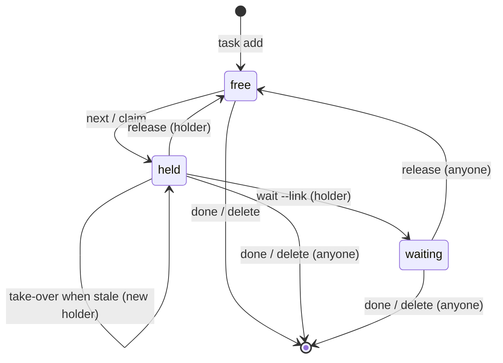

# crm-cli: task claims for parallel agents

*   **Author:** aryrabelo
*   **Status:** Proposed
*   **Date:** 2026-11-03
*   **Predecessor:** EGM brainstorm of 2026-11-03. The owner's decisions are quoted, with their date, where they are used.

--------------------------------------------------------------------------------

## Overview

`crm` is a local-first CRM CLI backed by one SQLite file (`~/.crm/crm.db`). The owner's job-search agents use its tasks as the list of planned follow-ups. These agents are OMP sessions in bora panes, OpenBot agents and Claude Code. Several of them run at the same time against the same database to get through the list faster.

This design adds task claims to the owner's fork of crm (`~/Sites/personal-team/crm-cli`).
- An agent asks for the next task, and in one database statement crm picks the most urgent free task and records the agent as its holder.
- The holder writes a progress note before each external side effect.
- When the work needs the owner (an email or WhatsApp draft to approve), the agent moves the task to the `waiting` state, which no agent picks.
- The holder finishes with `done` or gives the task back with `release`.

The design also covers the switch of the live database and binary from upstream Homebrew 0.1.6 to the fork.

### Terms

*   **hold / holder:** an agent working a task, and that agent.
*   **claim:** the `task_claims` row of a task, and the `crm task claim` command.
*   **locator:** the string an agent passes with `--as` to say who and where it is (grammar under "Locator").
*   **stale:** a hold is stale when `now − updated_at ≥ 2h`, that is, no claim, note or take-over for 2 hours. Every other mention of the 2h rule means this.
*   **waiting:** the state of a task whose artifact waits for the owner.
*   **free:** a task with no claim row, or with a row whose `state = 'free'`.

## The Problem

Every agent chooses work the same way: run `crm task list` and take the top task. Two agents started at the same time see the same top task and both act on it. The recruiter receives two emails. The owner runs several agents to split the work, and today they duplicate it.

Three facts make this hard to fix by convention alone:

1. **Tasks have no notion of "someone is on this".** The `tasks` table only has `completed` (0/1). The only atomic guard is at the end: a second `crm task done` on the same task gets a conflict, but by then the work has been done twice.
2. **Much of the work ends waiting on the owner, for hours.** An agent drafts the email and stops. Nothing in crm says a draft exists, so the next agent sees an open task and drafts again.
3. **The current order does not express urgency.** `list` sorts by due date and then by newest created (`internal/db/repo/task.go:90`). Priority is ignored, and same-day ties go to the newest task. Most open tasks have a date-only due date, so ties are common.

There is also a delivery problem. The binary in use is upstream Homebrew 0.1.6, and the live database has never been migrated by the fork. A claim that only the fork understands protects nothing while any agent still runs the old binary.

## Goals

*   **No double pick.** Two or more agents with different locators calling `crm task next` at the same moment never receive the same task. This is proven by a test that runs separate processes, not goroutines over one connection.
*   **Findable holder.** A held task shows the holder's locator, how long it has been idle and the latest progress note.
*   **Waiting is not abandoned.** A task whose artifact waits for the owner sits in the `waiting` state, with the artifact link and a note. `next` never returns it. `crm task list --waiting` shows everything waiting on the owner.
*   **Explicit, race-safe take-over.** A hold is never replaced automatically. Once a hold is stale, an incoming agent may check the holder at its locator and then replace it with an explicit take-over. Two agents taking over at once produce one winner and one conflict (exit 4).
*   **Urgency order shared by `list` and `next`** (defined in the Technical Plan). `next` returns the first row of that order that is free and due today or earlier, or undated.
*   **Same operations over CLI and MCP**, including the `done` that MCP lacks today.
*   **Safe cut-over of the live database.** The one-shot migration has a backup, a rehearsal on a copy, a verification step and a written rollback (Non-Functional Requirements). After the cut-over, every `crm` on the machine is the fork.
*   **Agents follow one written procedure** (resume-builder `modes/_custom.md`):
    1. `next`, or, to work ahead on a future-dated task, pick it from `list` and run `claim <id>`; on exit 4 pick another;
    2. `note` before each external side effect (send, draft, message); exit 4 means the hold was lost, so stop;
    3. do the side effect;
    4. `wait`, `done` or `release`.

    Rule: never act on a task you do not hold.

## Non-Goals

*   **Automatic take-over or heartbeats.** Holders do not ping crm. Idle time is shown, and replacing a holder is always a deliberate act.
*   **crm inspecting agents.** crm stores the locator. It does not query bora panes, OpenBot or processes.
*   **A full audit log of holds.** Only the previous holder is kept.
*   **Locks across machines.** One machine and one SQLite file.
*   **A dispatcher that assigns tasks**, or integration with messag or beads.
*   **Detecting that the owner sent a draft.** Leaving `waiting` is a manual `done` or `release` by the owner or any agent that checks.
*   **Changes to upstream `jdanielnd/crm-cli`**, or to the columns of its `tasks` table.

## Open Questions

*   **Who notices that the owner already sent a waiting draft?** If nobody runs `done`, the task stays `waiting` and leaves the queue without being finished. This design only makes waiting tasks visible: they show `STATE = waiting` in `list`, and `list --waiting` shows only them, with their links. Whether an agent should check Gmail/WhatsApp periodically to close them is out of scope here and needs an owner decision.

## Critical User Journeys (CUJs)

### CUJ 1: Two agents start at the same time

*   **Given**:
    - Tasks #13 and #14 are due today and free.
    - Agents A (`omp:~/Sites/resume-builder:bora-w3p2`) and B (`openbot:Pessoal:<thread>`) both run the fork binary.
*   **When**: Both run `crm task next --as <their locator>` concurrently.
*   **Then**:
    - One receives #13 and the other #14.
    - Neither gets an error.
    - `crm task list` shows both tasks held, with the holder and idle time.

### CUJ 2: Agent drafts an email and hands it to the owner

*   **Given**: Agent A holds #13.
*   **When**: A runs `crm task note 13 --as <A> "creating Gmail draft"`, creates the draft, then runs `crm task wait 13 --as <A> --link <draft URL> --note "draft ready"`.
*   **Then**:
    - #13 is `waiting`, has no holder, and A is its `previous_holder`.
    - `next` no longer returns it.
    - `crm task list --waiting` shows it with the link.
    - A holds nothing and can run `next` again.

### CUJ 3: Owner sends the draft

*   **Given**: #13 is `waiting`.
*   **When**: The owner sends the email, and then he or any agent runs `crm task done 13`. No `--as` is required.
*   **Then**: #13 is completed and its claim row is gone.

### CUJ 4: Owner rejects the draft

*   **Given**: #13 is `waiting`.
*   **When**: `crm task release 13 --note "first draft rejected"` is run by anyone, usually the owner or an agent he asked.
*   **Then**:
    - #13 is free again, its link is cleared and the note is kept.
    - The next agent to receive it from `next` sees the note.

### CUJ 5: Holder dies mid-work

*   **Given**: Agent A claimed #14 at 10:00, wrote its last note at 10:20, and its session crashed.
*   **When**: At 12:30, agent B runs `next`.
*   **Then**: `next` hands B a different free task and prints `stale: #14 held by <A>, idle 2h10m, note: …` on stderr.
*   **When**: B (or the owner) checks A's pane, finds it dead, and runs `crm task claim 14 --as <B> --take-over`.
*   **Then**: B holds #14 and A is its `previous_holder`.

### CUJ 6: Retry after a lost response

*   **Given**: Agent A ran `next`, which committed the claim of #15. The tool call timed out before A saw the output.
*   **When**: A runs `next` again with the same locator.
*   **Then**: crm returns #15 again, not a new task. A never holds more than one task.

### CUJ 7: Nothing to do

*   **Given**: Every task is done, held, waiting or due in the future.
*   **When**: An agent runs `next`.
*   **Then**: crm exits 3 with nothing on stdout (`[]` with `-f json`) and lists stale holds on stderr, so the agent can decide whether to check a holder.

### CUJ 8: Cut-over day

*   **Given**:
    - Homebrew `crm` 0.1.6 is installed.
    - The live DB is at `user_version=1`.
    - Agents and `crm mcp serve` processes are running.
*   **When**: The owner (or an agent he approved) follows the runbook in "Rollout & Rollback".
*   **Then**:
    - `schema_migrations` records 1 and 1001-1008.
    - `which -a crm` prints only `~/.local/bin/crm`, and `crm --version` prints `fork-<sha>`.
    - No `crm mcp serve` from the Homebrew binary is running.
    - All existing tasks, deals and people are intact.

### CUJ 9: Two agents take over the same stale task

*   **Given**: #14 is held by A and stale.
*   **When**: B and C both run `crm task claim 14 --take-over` with their locators at the same moment.
*   **Then**: One of them holds #14, with A as `previous_holder`. The other exits 4 with a message naming the new holder.

## Technical Plan (Architecture)

### Shape of the change

All new state lives in one fork-owned table, `task_claims`, added by migration `1008_task_claims.sql`.
- Upstream's `tasks` table and its columns stay unchanged, so the Homebrew binary can still read and write the migrated database.
- A task with no `task_claims` row is free.
- A row lives from the first claim until the task is completed or archived. `holder` is non-NULL only while the task is held. Every exit from held (wait, release, take-over) copies the old holder to `previous_holder`.



When a task becomes completed or archived, by any binary, a trigger removes its row (see "Cleanup trigger").

### Data model: `task_claims`

| Column | Type | Meaning |
|---|---|---|
| `task_id` | INTEGER PRIMARY KEY, FK `tasks(id)` ON DELETE CASCADE | One row per task, at most. |
| `state` | TEXT NOT NULL, CHECK in (`free`, `held`, `waiting`) | Current claim state. |
| `holder` | TEXT | Locator of the agent holding the task. Non-NULL only when `state = 'held'`. |
| `previous_holder` | TEXT | The holder before the last exit from `held`. |
| `updated_at` | INTEGER NOT NULL | Unix milliseconds of the last claim, take-over, note, wait or release. Staleness and idle time are measured from here. |
| `note` | TEXT | Latest progress note. |
| `link` | TEXT | Artifact the owner must act on (Gmail draft URL and similar). Non-NULL only when `state = 'waiting'`. |

Constraints:
- `CHECK ((state = 'held') = (holder IS NOT NULL))`.
- `CHECK ((state = 'waiting') = (link IS NOT NULL))`.
- A partial UNIQUE index on `holder` WHERE `state = 'held'`: the database refuses a second held task for the same locator.

Column values per state:

| State | `holder` | `previous_holder` | `note` | `link` |
|---|---|---|---|---|
| `held` | the agent | last holder before it, or NULL | kept unless a new note is given | NULL |
| `waiting` | NULL | the agent that ran `wait` | `--note` if given, else kept | required |
| `free` | NULL | the last holder | `--note` if given, else kept | NULL (cleared by `release`) |

Timestamps are Unix milliseconds computed in Go from an injected `now`, the same convention as `runs.heartbeat_at` (`1004_run_lease.sql`). Tests can then move the clock past 2h without sleeping. Task dates (`due_at`) stay as they are.

**Cleanup trigger.** Migration 1008 also creates `AFTER UPDATE OF completed, archived ON tasks WHEN NEW.completed = 1 OR NEW.archived = 1`, which deletes the task's `task_claims` row. The fork already uses triggers (`1006_run_items_workspace.sql`).
- Upstream's `done` and `delete` code stays unchanged.
- The trigger also runs when the Homebrew binary completes a task after a rollback. Without it, that path would leave an orphan `held` row, and the partial unique index would then block the agent's locator after a return to the fork.

### Every mutation is one autocommit statement

No `db.Begin()` around any claim write. A deferred transaction that reads first cannot upgrade to a write under contention and fails with `SQLITE_BUSY` instead of waiting on `busy_timeout`. A single statement takes the write lock before it reads, so a second process waits (up to 5 s, `busy_timeout = 5000`) and then sees the committed state.

**Busy timeout first.** `setPragmas` in `internal/db/db.go` sets `busy_timeout = 5000` before every other pragma. Before this change `journal_mode = WAL` ran first, with no wait, so 16 processes opening the database at once could exit 1 with `database is locked` before any claim statement ran.

Zero rows changed means a precondition failed. The code then reads the row once to build the message and exits 3 (unknown, completed or archived task) or 4 (anything else). One bounded exception, copied from `run.Store.Claim` (`internal/run/lease.go:45-71`): when `claim` fails and the read finds the task free (a concurrent `release` freed it between the statement and the read), `claim` runs its statement again, at most 3 times in total, and only then reports the conflict it reads. There is no other retry.

### The atomic pick (`next`)

```sql
INSERT INTO task_claims (task_id, state, holder, updated_at)
SELECT t.id, 'held', :as, :now
FROM tasks t LEFT JOIN task_claims c ON c.task_id = t.id
WHERE t.completed = 0 AND t.archived = 0
  AND (c.task_id IS NULL OR c.state = 'free')
  AND (date(t.due_at) IS NULL OR date(t.due_at) <= :today)
  AND NOT EXISTS (SELECT 1 FROM task_claims h WHERE h.holder = :as AND h.state = 'held')
ORDER BY <urgency order>
LIMIT 1
ON CONFLICT (task_id) DO UPDATE
  SET state = 'held', holder = excluded.holder, updated_at = excluded.updated_at
  WHERE task_claims.state = 'free'
RETURNING task_id;
```

- A locator that already holds a task never inserts, because of the `NOT EXISTS` clause.
- Re-holding a `free` row keeps its `previous_holder` and note.
- If the statement returns no row, `next` reads the task this locator holds. If there is one, it returns it (CUJ 6). Otherwise it exits 3.
- The partial unique index stays as a last guard. If it ever fires, the error is returned as-is (exit 1).
- **`:today`** is the local calendar date computed in Go. SQLite's `date('now')` is UTC and would make tomorrow's tasks eligible at 21:00 in Brazil. Note that `date()` also converts a `due_at` with a UTC offset (`2026-11-03T23:00:00-03:00`) to its UTC date (`2026-11-04`); date-only and offset-free values keep their calendar date.

**Urgency order**, one unexported constant in `internal/db/repo/task.go`, used by `FindAll` (so by `task list`, `crm_task_list`, `crm status` and `crm context`) and by `next`:

```sql
CASE WHEN date(t.due_at) IS NULL THEN 1 ELSE 0 END,
date(t.due_at) ASC,
CASE t.priority WHEN 'high' THEN 0 WHEN 'medium' THEN 1 ELSE 2 END,
t.created_at ASC,
t.id ASC
```

- `date()` normalizes both `2026-11-03` and `2026-11-03T10:00:00`, so mixed formats stop sorting as plain strings.
- Values that `date()` cannot parse count as undated everywhere: they sort with the undated tasks and are eligible for `next`.
- No new validation on `--due`.

### Other operations

- **`claim <id> --as L`:** one statement that inserts a held row, or updates a `free` row to held, only when the task is open, free, and `L` holds nothing. This is the path for tasks whose due date is still in the future. If `L` already holds this same task, `claim` returns it with exit 0, like a repeated `next` (CUJ 6). Neither repeat refreshes `updated_at`: only a claim that changes the row, a take-over, a note, a wait or a release does.
- **`claim <id> --as L --take-over`:** one statement:

  ```sql
  UPDATE task_claims
  SET previous_holder = holder, holder = :as, updated_at = :now
  WHERE task_id = :id AND state = 'held' AND updated_at <= :now - 7200000
    AND NOT EXISTS (SELECT 1 FROM task_claims h WHERE h.holder = :as AND h.state = 'held')
  ```

  Zero rows: exit 4 with the holder and idle time. Two agents taking over at once: the first commits and sets `updated_at = now`, so the second's WHERE is false and it exits 4 (CUJ 9).
- **`note <id> --as L "<text>"`:** holder only. Overwrites `note` and sets `updated_at = now`, so an agent that writes notes never goes stale.
- **`wait <id> --as L --link <url> [--note "<text>"]`:** holder only. Sets `state = 'waiting'`, `link`, `previous_holder = holder`, `holder = NULL`. The locator is free to take a new task.
- **`release <id> [--as L] [--note "<text>"]`:**
  - Held: only the holder may release it (`--as` required).
  - Waiting: anyone may release it, including the owner without `--as`.
  - Sets `state = 'free'`, clears `link`, and copies `holder` to `previous_holder` when it was held.
- **`done <id>` and `delete <id>`** are unchanged upstream commands. Anyone may run them, and the cleanup trigger removes the row.
- **`list`** uses the urgency order and shows the claim of each task. `--waiting` shows only waiting tasks, with their links.
- **`show <id>`** shows the task with its claim.

**Exit rules.**
- Invalid input (`--as` grammar, missing `--link`, a held task released without `--as`) → 2.
- Unknown, completed or archived task → 3. An empty queue on `next` → 3.
- Any other failed precondition → 4, with a message naming the current state, holder and idle time: the task is held or waiting; the locator already holds another task (`claim`, `--take-over`); the hold is not stale; the caller is not the holder; the task is already free.

**Locator.** Required on `next`, `claim`, `note`, `wait`, and `release` of a held task. Validated by `model.ValidLocator`, called inside the repository methods, so the CLI and MCP share one check.
- Grammar, enforced (exit 2 otherwise): `<runtime>:<where>:<session>`, at least three colon-separated segments, none empty, at most 200 bytes, no control characters (any rune for which `unicode.IsControl` is true, including tab and newline).
- The session segment must be unique per live agent session. Where each runtime gets it (checked on 2026-11-03 on the owner's machine):

  | Runtime | Session part | Example locator |
  |---|---|---|
  | OMP in a bora pane | `$HERDR_PANE_ID` (bora exports it into every pane; `bora pane current` prints the same pane). There is no `$BORA_PANE_ID`. | `omp:~/Sites/resume-builder:w19V:p6` |
  | OMP outside bora | `$PI_SESSION_ID` | `omp:~/Sites/resume-builder:01a1a3bc-…` |
  | OpenBot | NOT DERIVABLE here: no `openbot` CLI or environment variable carrying a thread id exists on this machine. The OpenBot agent must pass its own thread id. | `openbot:Pessoal:<thread>` |
  | Claude Code | NOT DERIVABLE from the environment: Claude Code hands its session id to hooks on stdin, not to the shell. Use the bora pane id when it runs in a bora pane. | `claude:~/Sites/resume-builder:<pane>` |

  The owner uses `owner:<where>:<anything>`.
- Two live agents with the same locator are treated as one agent and can receive the same task. This is a stated precondition (see Risks & Mitigations), not something crm can detect.

### Output

- **Rows.** Every task row (`list`, `show`, and the result of `next`, `claim`, `note`, `wait`, `release`) is the existing task map plus flat keys:
  - `claim_state` (`held`, `waiting` or `free`; absent when the task has no claim row);
  - `claim_holder`, `claim_previous_holder`, `claim_note`, `claim_link`;
  - `claim_updated_at`: UTC, layout `2006-01-02T15:04:05Z` (seconds, no fraction);
  - `claim_idle`: `model.FormatIdle(now − updated_at)`.

  Absent values are omitted in JSON and empty in table/CSV. `-f json` prints an array, as `task show` does today. `-q` prints the id.
- **Idle format.** `model.FormatIdle(d time.Duration) string` is the one formatter. It truncates to the minute and prints hours and minutes only: `2h41m`, `2h0m`, `41m`; anything under one minute (or negative, from a clock step) prints `0m`. The repository calls it when it fills `Claim.Idle` and `StaleHold.Idle`; the CLI and MCP only print what the repository returns.
- **Table columns.** `list` and `show` print `ID`, `Title`, `Due`, `Priority`, `Done`, `Person`, then `State`, `Holder`, `Idle` (go-pretty prints headers upper-case: `STATE`, `HOLDER`, `IDLE`). `list --waiting` adds `Link` last. `next`, `claim`, `note` and `release` print the `list` columns; `wait` prints the `list --waiting` columns.
- **Empty queue.** `next` exits 3. With `-f json` it writes `[]` and a newline to stdout itself; in table, CSV, TSV and `-q` it writes nothing. It does not call `format.Output`, which would print `No results.`.
- **Stale report.** `next` and `list` write one line per stale hold to stderr, in every format: `stale: #14 held by <locator>, idle 2h41m, note: …` (`, note: …` only when there is a note). Nothing stale is added to stdout. crm never acts on stale holds. `printStale` in `internal/cli/task_claim.go` (file 7) is the only formatter of these lines; `list` (file 8) calls it.
- **MCP.** Tools return the same row shape through `jsonResult` (`internal/mcp/server.go:233`), and errors through `mcpError` (`server.go:295`). `crm_task_next` returns a non-error result `{"task": {...} | null, "stale_holds": [...]}`, so the agent sees stale holds even when the queue is empty. `stale_holds` is `[]`, never `null`; each element is a `StaleHold` (`task_id`, `title`, `holder`, `idle`, `note` when present).

### Components touched

```text
internal/cli/task.go ──▶ internal/cli/task_claim.go ──┐
                                                     ├──▶ internal/db/repo/task_claim.go ──▶ task_claims + trigger (1008)
internal/mcp/serve.go ──▶ internal/mcp/task_claim.go ─┘                 │
internal/mcp/server.go (crm_task_list) ──────────────────────────────────┤
                                                                        └──▶ internal/db/repo/task.go (scanTask, columns, urgency order)
```

- **`internal/db/repo/task_claim.go` (new fork file in the repo package, `DBTX`):** `TaskClaimRepo` with `Next`, `Claim`, `TakeOver`, `Note`, `Wait`, `Release`, `ForTasks`, `Stale`. It reuses `scanTask` and the task column list from `task.go`. Database queries live in `repo` (`CLAUDE.md:145`), and the fork already adds repo files (`custom_field.go`, `import.go`).
- **`internal/db/repo/task.go` (modify):** the column list becomes one unexported constant shared with the claim repo; the `ORDER BY` at line 90 becomes the urgency order; `FindAll` honors a new `Waiting` filter.
- **`internal/model/types.go` (modify):** `Claim`, `TaskWithClaim`, `StaleHold`, the claim states, the locator validator and `FormatIdle`.
- **`internal/db/db.go` (modify):** `busy_timeout` becomes the first pragma ("Busy timeout first").
- **CLI:** `internal/cli/task_claim.go` (new) and wiring in `task.go`.
- **MCP:** `internal/mcp/task_claim.go` (new), registered from `serve.go`; `crm_task_list` in `server.go` attaches claims.
- `list` and `show` keep calling `FindAll`/`FindByID` and attach claims with one `ForTasks` query.

## Alternatives Considered

### Alternative A: A dispatcher hands out disjoint task ids (no code)

*   **Pros**: Zero code. The agent that starts the others runs `crm task list` and gives each one its own ids ("A: 10, 12; B: 11").
*   **Cons**:
    - It only works when one dispatcher starts every agent and nobody picks work on their own.
    - Agents started from different places (a bora pane, OpenBot, a cron) do not share a dispatcher.
    - A task finished early cannot be handed to an idle agent without going back to the dispatcher.
*   **Reason for Rejection**: The owner reports that agents choose their own work. This is the workload the feature exists for.

### Alternative B: Move planned work to beads (`bd`) and use its claim

*   **Pros**: beads already has the concept of claiming an issue.
*   **Cons**: Follow-ups have lived in crm since 2026-10-26, linked to deals and people (resume-builder `AGENTS.md:489`), and the application tracker is rendered from crm.
*   **Reason for Rejection**: The owner ruled out beads permanently (2026-11-03: "never use bd again").

### Alternative C: Route tasks through messag

*   **Pros**: messag is already the mailbox where agents and people exchange work.
*   **Cons**:
    - messag delivers each message to one recipient and marks it read for that recipient. It has no shared pool where several agents compete for one item.
    - It runs on Cloudflare D1, away from the local crm data that the tasks link to.
*   **Reason for Rejection**: It solves a different problem: addressed delivery, not shared work.

### Alternative D: File locks per task (`lib/dir-lock.mjs` in resume-builder)

*   **Pros**: resume-builder already has a directory-lock helper. No crm change is needed.
*   **Cons**:
    - It is a second, invisible store. `crm task list` and the MCP cannot show who holds what.
    - Agents outside resume-builder (OpenBot) would need the same helper.
    - A lock directory left behind by a dead agent has no owner or note attached.
*   **Reason for Rejection**: Holds must be visible next to the task, through every way agents reach crm.

### Alternative E: Claim columns on `tasks` instead of a separate table

*   **Pros**: No JOIN in `list` and `show`.
*   **Cons**:
    - It widens a table upstream owns, which raises merge debt when syncing with `jdanielnd/crm-cli`.
    - It makes rollback to the Homebrew binary depend on every new column being nullable with no constraints.
    - It loses the primary-key guard and the partial unique index on the holder.
*   **Reason for Rejection**: The owner chose a separate table (2026-11-03) so that upstream's `tasks` stays unchanged. A JOIN is a small cost for a rollback with no schema change to `tasks` and for database-level guards.

### Alternative F: Heartbeat lease with automatic take-over (copy of the `runs` lease)

*   **Pros**: It is already implemented for runs (`internal/run/lease.go`), and dead holders are recovered with no human step.
*   **Cons**:
    - Runs have one long-lived executor process that can renew every 10 seconds. An agent calls `crm` in short-lived processes and has no loop to send heartbeats from.
    - An agent that is thinking, or waiting on a tool, would lose its task.
    - Automatic take-over is how a duplicate draft happens.
*   **Reason for Rejection**: The design keeps the lease's conflict style, and replaces heartbeats with notes written before side effects, a visible idle time and an explicit take-over.

### Alternative G: Keep waiting work held, alive through notes, instead of a `waiting` state

*   **Pros**: One state fewer. An agent that waits on the owner keeps its hold alive by writing notes.
*   **Cons**:
    - The agent that made the draft usually ends its session. Nobody keeps writing notes, so the hold goes stale and the next agent drafts again.
    - The owner has no single list of what waits on him.
*   **Reason for Rejection**: The owner chose a distinct waiting state (2026-11-03). Measuring idle time from the last note is kept for held tasks only; waiting is still its own state.

### Alternative H: crm detects the agent's identity (pid, cwd, environment)

*   **Pros**: Agents would not need to pass `--as`.
*   **Cons**:
    - Each `crm` call is a process that exits within milliseconds, so its pid and cwd describe crm, not the agent.
    - Over `crm mcp serve`, every agent would get the server's identity.
    - Each runtime (bora, OpenBot, Claude Code) exposes different environment variables.
*   **Reason for Rejection**: The values would be misleading. The agent knows where it lives and says so.

### Alternative I: Only `claim <id>`, no `next`

*   **Pros**: Smaller API.
*   **Cons**:
    - Agents still read the same top line from `list` and collide on it.
    - The loser gets exit 4 and needs a "try the next one" loop written into every agent's prompt.
*   **Reason for Rejection**: Choosing and holding must be one operation for parallel agents to split the work. `claim <id>` stays for work chosen on purpose.

### Alternative J: Fix the migration runner race now (`BEGIN IMMEDIATE` and re-read `schema_migrations` inside each migration)

*   **Pros**: Future fork releases could be installed while agents run, and no cut-over runbook would be needed.
*   **Cons**:
    - It changes code shared by all migrations, which needs its own tests.
    - The race only matters at the first start of a binary that carries new migrations. The fork has shipped seven migrations; each new one repeats this risk once.
*   **Reason for Rejection**: Out of scope for this feature. The runbook stops everything before migrating.

### Alternative K: Full append-only log of claim events

*   **Pros**: It would answer any "who did what, when" question about a task.
*   **Cons**: A second table, plus a write on every operation, with no current use case.
*   **Reason for Rejection**: `previous_holder` plus the note covers "who drafted before". `crm log` already records the external contacts themselves.

## Non-Functional Requirements

### Rollout & Rollback

One runbook, written for installing any fork build that carries migrations. CUJ 8, the README (file 15) and the Verification Plan point here.

1. Stop every agent. `pgrep -fl 'crm mcp serve'` and `lsof "$HOME/.crm/crm.db"` both print nothing.
2. `sqlite3 "$HOME/.crm/crm.db" ".backup $HOME/.crm/crm.db.bak-<date>-pre-fork"` (double quotes, so the shell expands `$HOME`; `~` does not expand inside quotes).
3. Rehearse on a copy of the backup: `<fork binary> --db <copy> task list` succeeds, and `sqlite3 <copy> "select version from schema_migrations"` returns 1 and 1001-1008.
4. Migrate the live DB with one process: `<fork binary> task list` (it uses `CRM_DB` when set, `internal/cli/root.go:72`; check that it points at `"$HOME/.crm/crm.db"` or is unset). Run the step 3 check on the live DB.
5. `brew uninstall crm`.
6. `go build -ldflags "-X main.version=fork-$(git rev-parse --short HEAD)" -o ~/.local/bin/crm ./cmd/crm`.
7. `which -a crm` prints only `~/.local/bin/crm`; `crm --version` prints `fork-<sha>`; every MCP client config that starts `crm mcp serve` uses `~/.local/bin/crm` or a PATH that contains it.
8. Restart agents. Repeat the `pgrep` check: every `crm mcp serve` runs `~/.local/bin/crm`.

**Rollback (primary).** Stop agents, `rm ~/.local/bin/crm`, `brew install jdanielnd/tap/crm`, keep the database. Upstream code never reads `task_claims`, and `tasks` is unchanged, so claims are ignored. Agents go back to working one at a time: the Homebrew binary ignores claims, so parallel agents would duplicate again.

**Rollback (fallback).** Restore the step 2 backup. Writes made after step 2 are lost.

Do not run `brew install crm` again except to roll back.

### Risks & Mitigations

| Risk | Mitigation |
|---|---|
| Two live agents share a locator and receive the same task. | Enforced locator grammar with a per-session last segment; "Locator" names where each runtime gets its session id, and marks the runtimes where crm's docs cannot derive one. Stated as a precondition, since crm cannot detect it. |
| An old `crm mcp serve` keeps running the Homebrew binary and bypasses claims. | Runbook steps 1 and 8 (`pgrep`, `lsof`). |
| Rollback brings duplicates back. | The rollback step returns agents to one at a time. |
| Concurrent first start of a new binary races on migrations. | The runbook stops everything and migrates with one process (Alternative J). |
| Waiting tasks pile up forgotten. | `list` shows them as `waiting`, `list --waiting` lists them; who closes them is the Open Question. |
| Local vs UTC date makes tomorrow's tasks eligible in the evening. | `:today` is computed in Go in local time. |
| An upstream migration that rebuilds `tasks` drops the cleanup trigger. | The trigger tests in file 6 fail when the trigger is missing; any upstream sync runs the full suite. |

### Security

The locator is not authentication: any caller can pass another agent's locator. crm trusts the agents on this machine. The owner uses this to release or take over a task on an agent's behalf.

## Future Improvements

*   **Migration runner:** see Alternative J.
*   **Closing waiting tasks:** see the Open Question.

## Additional Resources

*   Fork `CLAUDE.md` (layers at line 149, adding an MCP tool at lines 525-530).
*   `internal/run/lease.go` and `internal/db/migrations/1004_run_lease.sql`: the conflict style reused here.
*   `internal/db/migrations/1006_run_items_workspace.sql`: trigger precedent.
*   resume-builder `AGENTS.md:159` and `AGENTS.md:489`: how the job-search agents use crm today.

--------------------------------------------------------------------------------

## Detailed Implementation Plan

Two repositories are touched: the fork `~/Sites/personal-team/crm-cli` (paths below are relative to it unless marked) and `~/Sites/resume-builder` (marked **[resume-builder]**).

Rules for each operation are defined once, in the Technical Plan. The entries below say where each rule is implemented and do not repeat it.

Work order:
1. Migration, model, and the existing migration test (files 1-3).
2. Repository and its tests (files 4-6).
3. CLI, MCP and their tests, including the MCP tool-count test (files 7-14).
4. Fork docs (files 15-19).
5. Merge.
6. Smoke test and rollback check on a copy (Verification Plan).
7. Cut-over ("Rollout & Rollback"), on a day the owner approves.
8. resume-builder docs (files 20-22).

### Target Files to Create/Modify

#### 1. `internal/db/migrations/1008_task_claims.sql` (Create)

*   **Type / Scope**: SQL migration (fork range ≥ 1001, picked up by `loadMigrations` in `internal/db/db.go`).
*   **Proposed Changes**:
    - `-- up`: the `task_claims` table, its two CHECK constraints and the partial unique index `idx_task_claims_holder_held`, exactly as in "Data model"; the trigger `task_claims_clear_on_close` ("Cleanup trigger").
    - `-- down`: drop the trigger, the index and the table.
    - No column of any upstream table changes.
*   **Why**: The constraints and trigger apply to writes from any binary, including Homebrew 0.1.6.

#### 2. `internal/db/db_test.go` (Modify)

*   **Proposed Changes**: line 64: `1007` → `1008`, and the message names `1008_task_claims`.
*   **Why**: The test pins the newest migration and fails as soon as file 1 exists.

#### 3. `internal/model/types.go` (Modify)

*   **Type / Scope**: Domain types, next to `ValidPriority` (line 288).
*   **Proposed Changes**:
    - Claim states `ClaimFree`, `ClaimHeld`, `ClaimWaiting`, and `StaleAfter = 2 * time.Hour`.
    - `import "time"` (the file imports nothing today).
    - `ValidLocator(string) bool`: the grammar in "Locator". Table test in `internal/model/types_test.go`: valid three- and four-segment locators; empty first, middle and last segment; fewer than three segments; 200 bytes accepted and 201 refused; tab, newline and DEL refused (`unicode.IsControl`).
    - `FormatIdle(time.Duration) string` ("Idle format"), tested in the same file.
    - `Claim` with JSON tags carrying the flat keys of "Output": `State string` (`claim_state`); `Holder`, `PreviousHolder`, `Note`, `Link *string` (`claim_holder`, `claim_previous_holder`, `claim_note`, `claim_link`, all `omitempty`); `UpdatedAt string` (`claim_updated_at`, layout in "Output", formatted by the repo); `Idle string` (`claim_idle`); `IdleFor time.Duration` (`json:"-"`, used for staleness).
    - `TaskWithClaim struct { *Task; *Claim }`. `encoding/json` flattens both, and a nil `Claim` adds no keys, so MCP output is the existing task object plus `claim_*` keys.
    - `StaleHold` with snake_case tags: `TaskID int64 json:"task_id"`, `Title string json:"title"`, `Holder string json:"holder"`, `Idle string json:"idle"`, `Note *string json:"note,omitempty"`.
    - `TaskFilters` gains `Waiting bool`.
*   **Why**: One definition, used by the repo, CLI and MCP.

#### 4. `internal/db/repo/task.go` (Modify)

*   **Type / Scope**: Upstream task repository.
*   **Proposed Changes**:
    - The SELECT column list, written twice today (`FindByID`, `FindAll`), becomes one unexported constant, every column qualified with `t.` (`t.id, t.uuid, …`), that the claim repo also uses. `scanTask` is unchanged.
    - `FindByID` and `FindAll` both query `FROM tasks t`, so a claim-repo read that joins `task_claims` (which also has `updated_at`) is never ambiguous. `FindAll` orders by the urgency-order constant ("The atomic pick").
    - `filters.Waiting` adds `AND EXISTS (SELECT 1 FROM task_claims c WHERE c.task_id = t.id AND c.state = 'waiting')`.
    - `--overdue` keeps upstream's meaning (`due_at < datetime('now')`).
*   **Why**: `list`, `crm_task_list`, `crm status`, `crm context` and `next` share one order and one scan.

#### 5. `internal/db/repo/task_claim.go` (Create)

*   **Type / Scope**: Fork repository, `NewTaskClaimRepo(db DBTX) *TaskClaimRepo`.
*   **Proposed Changes**: methods, each one SQL statement as in the Technical Plan, plus at most one read to build an error message or the result:
    - `Next(ctx, as string, now time.Time, today string) (*model.Task, *model.Claim, error)`.
    - `Claim(ctx, id int64, as string, now time.Time) (*model.Task, *model.Claim, error)`.
    - `TakeOver(ctx, id int64, as string, now time.Time) (*model.Task, *model.Claim, error)`.
    - `Note(ctx, id int64, as, note string, now time.Time) (*model.Task, *model.Claim, error)`.
    - `Wait(ctx, id int64, as, link string, note *string, now time.Time) (*model.Task, *model.Claim, error)`.
    - `Release(ctx, id int64, as *string, note *string, now time.Time) (*model.Task, *model.Claim, error)`.
    - `ForTasks(ctx, ids []int64, now time.Time) (map[int64]*model.Claim, error)`.
    - `Stale(ctx, now time.Time) ([]model.StaleHold, error)`.

    Errors are `model.NewExitError` around `model.ErrValidation` (2), `model.ErrNotFound` (3) or `model.ErrConflict` (4), with the messages in "Exit rules". The wording follows `run.Store.Claim` (`internal/run/lease.go`), without importing `internal/run`.
*   **Why**: All claim SQL in one file of the package that owns queries.

#### 6. `internal/db/repo/task_claim_test.go` (Create)

*   **Type / Scope**: Unit tests, in-memory SQLite through `db.Open(":memory:")`, injected `now`/`today`, table-driven.
*   **Proposed Changes**: Cases:
    - **Urgency order (through `FindAll`):** most overdue first; priority breaks same-day ties; oldest created breaks equal priority; undated after dated; unparseable `due_at` sorts with undated; date-only and datetime values compare by calendar date.
    - **`Next`:** skips held and waiting; takes `free` rows; excludes future-dated, includes unparseable; returns the locator's current hold instead of a second task; `ErrNotFound` on an empty queue.
    - **`Claim`:** conflict on held or waiting, naming the holder; conflict when the locator already holds another task; works on a future-dated task.
    - **`TakeOver`:** refused when not stale; succeeds at exactly 2h idle; refused for a locator that holds another task; a `note` written at 1h59m makes the hold not stale.
    - **`Note`, `Wait`, `Release`:** non-holders get `ErrConflict`; column values match the per-state table; `Release` of a waiting task without `as` succeeds and clears `link`; `Release` of a free task conflicts.
    - **Trigger:** upstream `TaskRepo.Complete` and `Archive` remove the row, and the locator can hold a new task afterwards.
    - **`Stale`:** returns only held rows idle 2h or more.
*   **Why**: Tests each rule without processes, including the paths the Homebrew binary takes.

#### 7. `internal/cli/task_claim.go` (Create)

*   **Type / Scope**: Cobra subcommands of `crm task`, as fork files like `run.go` and `qualify.go`.
*   **Proposed Changes**:
    - `next`, `claim` (with `--take-over`, which calls `TakeOver`; otherwise `Claim`), `note`, `wait`, `release`, with the flags in "Other operations".
    - `--as` is validated in `RunE` with `model.ValidLocator` and returns `ErrValidation` (exit 2). Do not use `MarkFlagRequired`, which exits 1.
    - `today` is `time.Now().Format("2006-01-02")` in local time.
    - `taskWithClaimToMap(t *model.Task, c *model.Claim)`: calls `taskToMap` and adds the `claim_*` keys. `list`, `show` and the claim commands use it.
    - `printStale(w io.Writer, holds []model.StaleHold)`: the only formatter of the stale lines ("Output"). `next` and `list` call it.
    - `registerTaskClaimCommands(taskCmd)`.

#### 8. `internal/cli/task.go` (Modify)

*   **Proposed Changes**:
    - One call to `registerTaskClaimCommands` in `registerTaskCommands`.
    - `list` adds `--waiting` (sets `TaskFilters.Waiting`), attaches claims through `ForTasks`, adds the columns in "Output" and calls `printStale` (file 7).
    - `show` attaches the claim through `ForTasks` and prints the `list` columns, claim block included.
    - `taskToMap` keeps its signature, so `crm context` (`context.go:94` calls `tasksToMaps`) is unchanged.
    - `add`, `edit`, `done` and `delete` are unchanged.

#### 9. `internal/cli/task_claim_test.go` (Create)

*   **Type / Scope**: Integration tests with the binary built by the package `TestMain` (`internal/cli/person_test.go:17-39`), through the `crm()` helper (`person_test.go:58`). Do not declare another `TestMain`.
*   **Proposed Changes**:
    - **Race test:**
      1. Seed 5 due tasks with `crm --db <tmp> task add`, run one after another. This also migrates the database and switches it to WAL before any concurrent process starts.
      2. Start 16 processes of `crm --db <tmp> task next --as test:race:<i> -f json` at once (`exec.Cmd.Start` in a loop, then `Wait`).
      3. Assert exactly 5 exit 0 with 5 distinct ids, 11 exit 3 with `[]` on stdout, and no other exit code or `database is locked` on stderr.
      4. Repeat 5 times as subtests.
    - **Exit codes:**
      - 4 for a conflicting `claim`; 4 for `--take-over` on a free task and on a waiting task.
      - 2 for a missing or malformed `--as`; 2 for `wait` without `--link`; 2 for `release` of a held task without `--as`.
      - 3 for an empty queue; 3 for `claim`, `note`, `wait` and `release` on an unknown task, a completed task and an archived task (table-driven).
      - 0 for `claim` by the locator that already holds that task, which returns the task unchanged.
      - 1 when the partial unique index fires: the test inserts a held row for a locator directly through `db.Open` on the temp DB, then inserts a second one for the same locator and asserts the constraint error (no code path reaches it otherwise).
    - **Waiting flow:** `wait` then `list --waiting` shows the link; `next` from another locator skips the task.
    - **Done:** `done` with no `--as` on a waiting task succeeds and clears the claim.
    - **Stale report:** the test opens the temp DB with `db.Open` and backdates `task_claims.updated_at` by 3h; the stale line then appears on stderr of `next` and `list`, and not on stdout. Production code gets no clock override.
*   **Why**: Only separate processes prove the atomic pick. The lease race test runs goroutines over one connection (`internal/db/db.go:28`).

#### 10. `internal/mcp/task_claim.go` (Create)

*   **Type / Scope**: Fork MCP tools, following `CLAUDE.md:525-530`.
*   **Proposed Changes**:
    - `(*Server) registerTaskClaimTools()`, with typed input structs (`json` and `jsonschema_description` tags) registered through `gomcp.WithInputSchema[T]()`, like `batch.go`:
      - `crm_task_next` (`as` required);
      - `crm_task_claim` (`id`, `as` required; `take_over`);
      - `crm_task_note` (`id`, `as`, `note` required);
      - `crm_task_wait` (`id`, `as`, `link` required; `note`);
      - `crm_task_release` (`id` required; `as`, `note`);
      - `crm_task_done` (`id` required), through `TaskRepo.Complete`.
    - Each handler uses `time.Now()` and the local `today`, returns `model.TaskWithClaim` through `jsonResult`, and maps errors through `mcpError`. `crm_task_next` returns `{"task", "stale_holds"}` ("Output").
    - Descriptions state the rule: "Pick work with crm_task_next, or crm_task_claim a task from crm_task_list. Never act on a task you do not hold. Call crm_task_note before each external side effect."
*   **Why**: MCP agents get the same operations, including the `done` that MCP lacks today (`server.go:176-196`).

#### 11. `internal/mcp/serve.go` (Modify)

*   **Proposed Changes**: `Server` gains `tasks *repo.TaskRepo` and `claims *repo.TaskClaimRepo`, built in `New` from `db`. `New` calls `s.registerTaskClaimTools()` after `s.registerBatchTools()`. These are fork tools: `IsEntityTool` returns false for them, so the per-entity bench baseline does not offer them.

#### 12. `internal/mcp/server.go` (Modify)

*   **Proposed Changes**: `registerEntityTools(s, db, claims)` takes the server's one `TaskClaimRepo` (`s.claims`, built in `New`, file 11) and passes it to `taskListHandler`, which accepts a `waiting` boolean (sets `TaskFilters.Waiting`) and returns `[]model.TaskWithClaim`.

#### 13. `internal/mcp/batch_test.go` (Modify)

*   **Proposed Changes**: line 129: `27` → `33`, message `18 entity tools + 15 fork tools`.
*   **Why**: The test pins the exact tool count and fails as soon as file 10 registers its tools.

#### 14. `internal/mcp/task_claim_test.go` (Create)

*   **Type / Scope**: Tests through `batch_test.go`'s `connect` and `call` helpers, over every transport (in-process, stdio, HTTP).
*   **Proposed Changes**:
    - Two `crm_task_next` calls with different `as` return different tasks.
    - `crm_task_next` on an empty queue returns a non-error `{"task": null, ...}`.
    - `crm_task_claim` on a held task returns an error result naming the holder.
    - `crm_task_done` completes a waiting task and the trigger clears the claim.
    - `crm_task_list` with `waiting: true` returns only waiting tasks, with `claim_link`. `call` decodes into `map[string]any`, so the test file adds `callList`, which decodes the text of an array result into `[]map[string]any`.
*   **Why**: MCP and CLI must enforce the same rules.

#### 15. `README.md` (Modify)

*   **Proposed Changes**:
    - **"Tasks" (line 111):** the five new commands, `list --waiting`, the urgency order, and the stale report.
    - **MCP "Available Tools" (line 389):** the six tools.
    - **"About this fork" (line 12):** the "Rollout & Rollback" runbook, copied verbatim.
*   **Why**: The cut-over must be repeatable from the repo. `--version` alone cannot tell the two binaries apart today, since both print `dev`.

#### 16. `AGENT.md` (Modify)

*   **Type / Scope**: The agent-instructions template this repo ships for crm users.
*   **Proposed Changes**:
    - Add a "Working tasks with other agents" section with the procedure and rule from Goals, the locator grammar, and: "On a stale report, check the holder at its locator before `claim --take-over`."
    - Line 91: replace the `overdue: true` reminder with "Remind the user of overdue tasks; to act on one, hold it first."

#### 17. `CHANGELOG.md` (Modify)

*   **Proposed Changes** under `[Unreleased]`:
    - **Added:** task claims (`next`, `claim`, `note`, `wait`, `release`, `list --waiting`) and six MCP tools, including `crm_task_done`.
    - **Changed:** task order (due date, priority, oldest first) in `task list`, `crm_task_list`, `crm status`, `crm context` and the `crm_context` MCP tool; `crm_task_list` rows carry `claim_*` keys; `busy_timeout` is set before the other pragmas.

#### 18. `CLAUDE.md` (Modify)

*   **Proposed Changes**:
    - Project Structure: `internal/db/repo/task_claim.go`, `internal/cli/task_claim.go`, `internal/mcp/task_claim.go`.
    - MCP Server: the six tools.
    - Testing: claim races are tested with separate processes, not goroutines.

#### 19. `docs/designs/task-claims.md` (Modify, commit)

*   **Why**: This document, finalized and committed with the code it describes.

#### 20. **[resume-builder]** `modes/_custom.md` (Modify)

*   **Type / Scope**: The owner's house rules, which survive `update-system.mjs` (`DATA_CONTRACT.md`).
*   **Proposed Changes**: a "crm task claims" section, the canonical procedure for this repo:
    - the procedure and rule from Goals;
    - the locator `omp:<cwd>:<bora pane or OMP session id>`;
    - a draft waiting for Ary goes to `crm task wait <id> --as <locator> --link <draft URL>`;
    - `crm task list --waiting` is the "what is waiting on Ary" view.

#### 21. **[resume-builder]** `AGENTS.md` (Modify)

*   **Proposed Changes**:
    - **Line 159:** replace `brew install jdanielnd/tap/crm` with the fork binary (`~/.local/bin/crm`, built from `~/Sites/personal-team/crm-cli`), and state that the Homebrew formula is installed again only to roll back.
    - **Line 489:** one line: "Follow-ups: claim before acting, see `modes/_custom.md` › crm task claims."
*   **Note**: `AGENTS.md` is a system path (`lib/update-manifest.mjs:144`). If an update replaces it, reapply these two lines.

#### 22. **[resume-builder]** `docs/openbot-emprego.md` (Modify)

*   **Type / Scope**: OpenBot agent instructions, in Portuguese. OpenBot reaches crm through MCP (line 20).
*   **Proposed Changes**: at line 47, in Portuguese, the same procedure with the MCP tools `crm_task_next`, `crm_task_claim`, `crm_task_note`, `crm_task_wait`, `crm_task_done`, `crm_task_release`, and the locator `openbot:Pessoal:<thread>`.
*   **Note**: `docs/` is a system path (`lib/update-manifest.mjs:453`). If an update replaces the file, reapply the edit.

#### Intentionally unchanged

*   **`docs/index.html`:** upstream's marketing page. Its MCP tool list is not part of the fork's contract.
*   **Migration runner race (`internal/db/db.go` `runMigrations`):** handled by the runbook (Alternative J). Only `setPragmas` changes in `db.go`.
*   **`internal/run/`:** the claim reuses the lease's patterns, not its code.
*   **`--due` input:** no new validation.

### Verification Plan

*   **Compilation/Build**: `go build -o <scratch path outside the repo>/crm ./cmd/crm`.
*   **Unit and integration tests**: `go test -race ./...` (CI), including the race test of file 9.
*   **Static Analysis & Linting**: `go vet ./...` and `golangci-lint run` (CI `lint` job).
*   **Test Coverage Requirement**: every rule in the Technical Plan has at least one test in files 6, 9 or 14. No percentage target.
*   **Smoke test on a copy of the live database (before the cut-over)**:
    1. `sqlite3 "$HOME/.crm/crm.db" ".backup <copy>"`.
    2. `<fork binary> --db <copy> task list` shows the same task count as before the migration, with the same data.
    3. Two terminals run `task next --as test:smoke:a` and `--as test:smoke:b` at once and get different tasks.
    4. `wait`, `list --waiting` and `done` behave as in CUJ 2-4.
*   **Rollback check on the copy**: `$(brew --prefix)/bin/crm --db <copy> task list` and `task add` succeed against the migrated copy.
*   **After the cut-over**: the checks of runbook steps 7 and 8 pass, and two agents in two bora panes each run `crm task next` and get different tasks.

--------------------------------------------------------------------------------

*Drafted with EGM*
